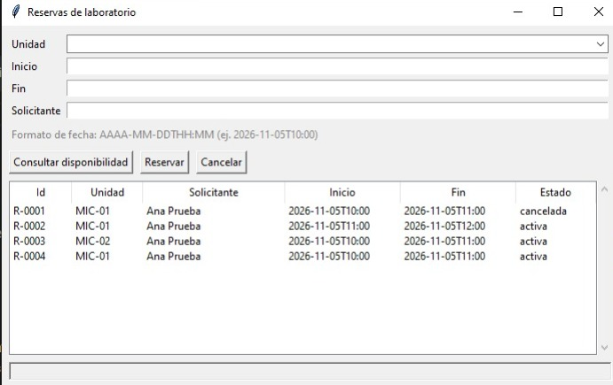

# Evidencia 05: Episodio 3 (interfaz gráfica)

- Fecha: 2026-11-03
- Herramienta: OpenCode 1.19.5, modelo mostrado: MiMo-V2.6-Flash Free
- Código de este episodio: commit
  [67daca2](https://github.com/WolfFenrir22/Desafio_Agente/commit/67daca2).
  Esta evidencia se agregó después, en el commit
  [0ffca81](https://github.com/WolfFenrir22/Desafio_Agente/commit/0ffca81).
- Lo que informó el agente está en las secciones 2 y 3. Lo que ejecuté yo está en la sección 5.


- Este archivo se armó con ayuda del agente (OpenCode) a partir de textos que le pegué; lo revisé y corregí yo.

## 1. Instrucción que le di
(Texto preparado con ayuda del asistente de chat; es el que le envié. Restauré los saltos de línea.)

```
Leé SPEC.md, AGENTS.md, reservas/dominio.py y reservas/repositorio.py.

Tarea: interfaz gráfica mínima con tkinter (RF-10) en reservas/gui.py,
que se abra con `python -m reservas.gui`.

La ventana debe permitir: elegir la unidad (desde el inventario), escribir
inicio y fin (formato AAAA-MM-DDTHH:MM) y el solicitante, y tres botones:
Consultar disponibilidad, Reservar y Cancelar (la reserva seleccionada en
la tabla). Una tabla con todas las reservas, activas y canceladas, que se
actualice después de cada operación. Los errores (entrada inválida,
superposición, etc.) se muestran en un mensaje sin cerrar la aplicación.

La interfaz solo debe llamar a funciones de repositorio.py; no dupliques
reglas de negocio. La base por defecto es reservas.db en la raíz. Mantenela
simple, sin estilos elaborados.

Antes de tocar nada, decime qué archivos vas a crear o modificar. No toques
SPEC.md, inventario.json ni las pruebas existentes. No hagas commits.
Al terminar, ejecutá las pruebas existentes, mostrame la salida real y
decime cómo abrir la ventana.
```

## 2. Plan del agente (antes de actuar)
Archivos que voy a tocar:
1. Crear reservas/gui.py — ventana Tkinter con combobox de unidad (desde inventario.json), campos inicio/fin/solicitante, botones Consultar/Reservar/Cancelar, tabla de todas las reservas y barra de estado. Solo llama a repositorio.py (consultar, crear, cancelar, listar); los errores se muestran con messagebox sin cerrar la app.
2. Modificar reservas/repositorio.py — agregar una función pública cargar_inventario(ruta) (3 líneas, delega en dominio.cargar_inventario) para que la GUI dependa solo del repositorio. No toca lógica existente.
No toco SPEC.md, inventario.json ni las pruebas.

El agente pidió permiso para empezar y se lo di. Aprobé el plan antes de
revisarlo con el asistente de chat; lo revisé con él después.

## 3. Informe final del agente (lo que dijo; no es mi verificación)
(Al copiarlo recorté la lista de pruebas: donde dice `...` el original mostraba las líneas intermedias.)

Archivos:
- Creado reservas/gui.py (ventana Tkinter, RF-10).
- Modificado reservas/repositorio.py:67 — solo agregué cargar_inventario() como passthrough para que la GUI use únicamente el repositorio.
Pruebas reales (python -m unittest discover -s tests -v):
...
test_reinicio_requiere_confirmacion ... ok
----------------------------------------------------------------------
Ran 23 tests in 0.486s

OK
(También verifiqué que reservas.gui importa y que la ventana se construye sin errores; borré el reservas.db vacío que dejó esa prueba.)
Cómo abrir la ventana (desde la raíz del proyecto):
python -m reservas.gui
Elegí la unidad en el combo, escribí inicio/fin (AAAA-MM-DDTHH:MM) y solicitante, y usá los tres botones; la tabla se refresca tras cada operación y los errores aparecen en un cuadro de diálogo sin cerrar la app.

## 4. Observación mía sobre el informe
El agente dijo haber borrado un `reservas.db` vacío que había creado su propia
prueba. AGENTS.md indica que los datos solo se borran con el comando explícito
de reinicio; en este caso el archivo estaba vacío y lo había creado el propio
agente, así que no se perdió nada, pero lo dejo anotado.

## 5. Mi verificación (lo que ejecuté yo)

### 5.1 Pruebas automáticas
- Comando: python -m unittest discover -s tests -v
- Python 3.15.2, Windows 10, terminal de VS Code
- Resultado: Ran 23 tests, OK.


### 5.2 Revisión del cambio en repositorio.py y de gui.py
Revisé en Source Control que el cambio en `repositorio.py` fuera solo la función
`cargar_inventario`, y revisé `gui.py` y `repositorio.py` con las búsquedas de
VS Code (uso del reloj del sistema, importaciones de `dominio`, ruta de la base).
No encontré problemas. Para que pueda repetirse, estos son los comandos
equivalentes, desde la raíz del repositorio:

| Punto | Comando | Resultado esperado | Lo que vi |
|---|---|---|---|
| gui.py no usa el reloj | `git grep -n "datetime.now\|date.today" 67daca2 -- reservas/gui.py` | sin resultados |  |
| Qué toma gui.py de dominio | `git grep -n "dominio" 67daca2 -- reservas/gui.py` | solo constantes o nombres, sin reglas de negocio |  |
| El cambio en repositorio.py | `git diff 78313f3 67daca2 -- reservas/repositorio.py` | solo líneas agregadas (la función cargar_inventario) |  |
| No se tocaron pruebas, SPEC ni inventario | `git diff --stat 78313f3 67daca2 -- tests SPEC.md inventario.json` | sin salida |  |

### 5.3 Prueba manual de la ventana
Comando: `python -m reservas.gui`; datos ficticios; ejecutada y observada por mí
el 2026-11-03. La columna "Observado" la redactó el asistente de chat a partir
de lo que le informé; los pasos 1 y 11 además tienen respaldo en capturas
(ver abajo).

| Paso | Acción | Esperado | Observado |
|---|---|---|---|
| 1 | Abrir la ventana | Tabla vacía | Se cumplió: la ventana abrió con la tabla vacía |
| 2 | MIC-01, 2026-11-05T10:00 a 2026-11-05T11:00, solicitante Ana Prueba | R-0001 activa | Se cumplió: se creó R-0001 activa |
| 3 | MIC-01, 10:30 a 11:30 del mismo día | Mensaje de superposición, tabla igual | Se cumplió: se rechazó con mensaje y la tabla no cambió |
| 4 | MIC-01, 11:00 a 12:00 | Se acepta (R-0002) | Se cumplió: se aceptó como R-0002 |
| 5 | MIC-02, 10:00 a 11:00 | Se acepta (R-0003) | Se cumplió: se aceptó como R-0003 |
| 6 | Solicitante con solo espacios | Se rechaza | Se cumplió: se rechazó |
| 7 | Fecha 2026-02-30T10:00 | Se rechaza | Se cumplió: se rechazó |
| 8 | Consultar MIC-01, 10:30 a 11:00 | Informa R-0001 como bloqueo | Se cumplió: informó R-0001 como bloqueo |
| 9 | Cancelar R-0001 (seleccionada) | Sigue en la tabla como cancelada | Se cumplió: R-0001 quedó en la tabla con estado cancelada |
| 10 | MIC-01, 10:00 a 11:00 | Se acepta (R-0004) | Se cumplió: se aceptó como R-0004 |
| 11 | Cerrar la ventana y volver a abrirla | Las reservas siguen, con sus estados | Se cumplió: al reabrir siguen R-0001 cancelada y R-0002, R-0003 y R-0004 activas (ver captura) |

Captura de la ventana tras cerrar y reabrir la aplicación (paso 11):



Nota: al reabrir escribí `python -m reservas.gui.` con un punto final por error;
Python dio ModuleNotFoundError. Lo repetí sin el punto y funcionó. No es una falla
del agente.

## 6. Decisión
Acepté el resultado del Episodio 3. Las 23 pruebas siguen pasando, la ventana
cumplió los 11 pasos de la prueba manual, gui.py solo llama al repositorio y el
cambio en repositorio.py fue solo la función cargar_inventario. No hubo
correcciones al agente.

## 7. Limitación
Las pruebas automáticas no cubren la ventana: esa parte se comprueba solo con el
procedimiento manual de la sección 5.3.